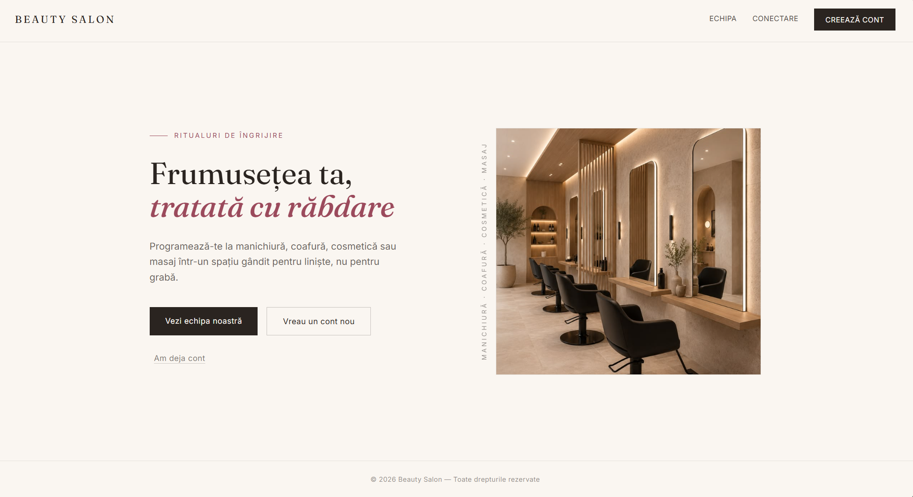
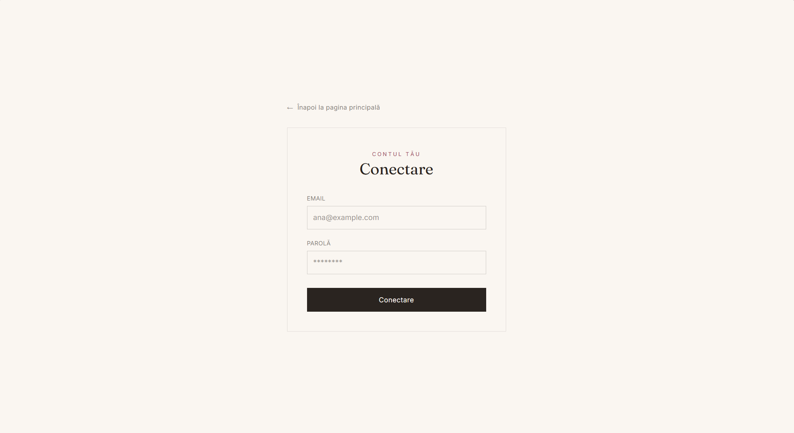
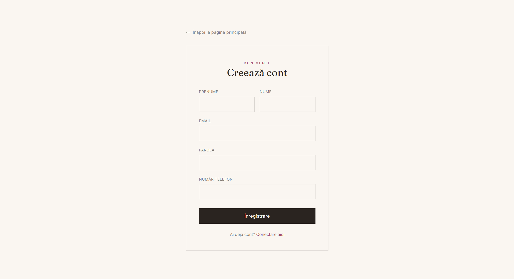
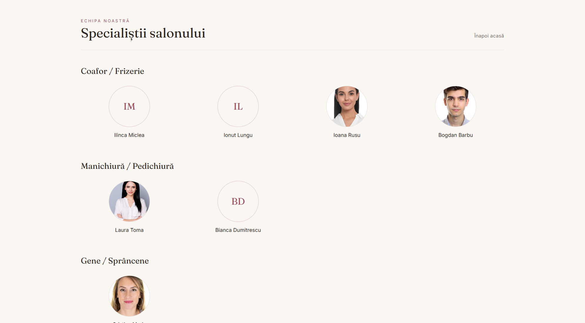
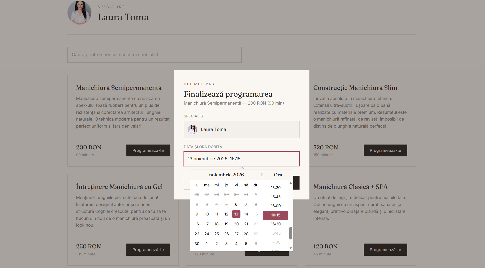
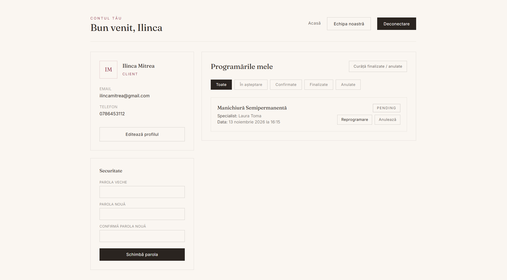
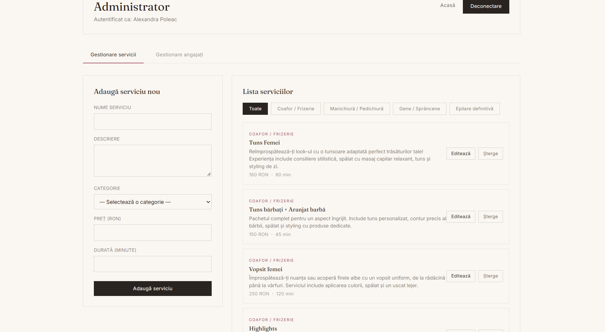
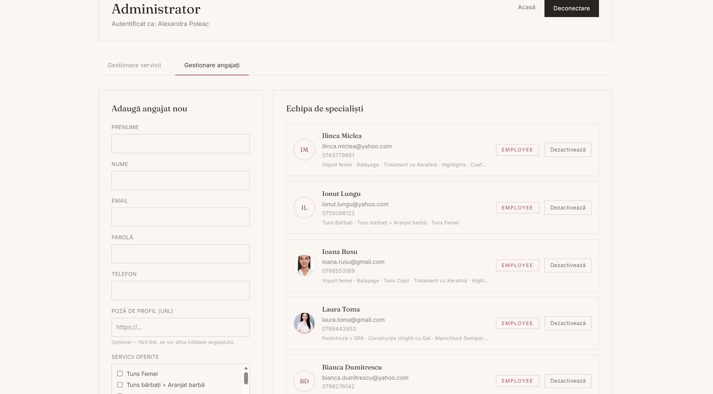
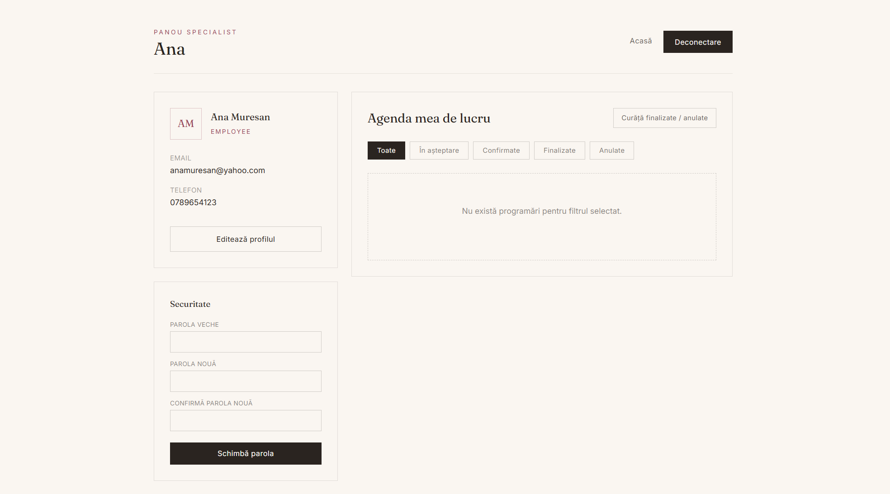

# Beauty Salon - Full-Stack Booking Platform

A full-stack web application for managing a beauty salon. Clients browse services and book appointments online, employees manage their schedules, and administrators manage services and staff.

Built with Spring Boot 3 (Java 17), React 19, MySQL and JWT authentication. The codebase includes 53 automated tests.

The home page of the beauty salon: 

## Table of Contents
- [Features](#features)
- [Automatic Behavior](#automatic-behavior)
- [Tech Stack](#tech-stack)
- [Architecture](#architecture)
- [Business Rules](#business-rules)
- [Testing](#testing)
- [API Overview](#api-overview)
- [Screenshots](#screenshots)
- [Future Improvements](#future-improvements)

## Features

### Visitor(Unauthenticated) 
- **Home page**: Salon introduction and overview.
- **Team page**: View all active specialists and their profile pictures.
- **Specialist profiles**: View the specific services each specialist offers, complete with a search function.
- **Registration**: Account creation with strict validation (strong password, phone number format, unique email).

### Client
- **Authentication**: Secure login with role-based redirection to the appropriate dashboard.
- **Service Catalog**: Browse all services with search functionality (by name or description) and category filters (hair, nails, lashes & brows, laser hair removal).
- **Booking System**: 
  - Dynamic calendar that automatically blocks Sundays and past dates.
  - 15-minute time slot increments (09:00 to 18:00).
  - Real-time availability: booked slots are hidden from the calendar automatically.
  - Appointment end time is calculated dynamically based on service duration.
- **Notifications**: Automated email confirmation sent upon successful booking.
- **Profile Management**: 
  - Edit personal details and update passwords (requires current password validation).
  - Manage appointment history with status filters (All, Pending, Confirmed, Completed, Cancelled).
  - Reschedule or cancel active appointments.
  - Toggle visibility for completed/cancelled appointments to maintain a clean list.

### Employee (Specialist)
- **Dashboard**: Centralized view of all assigned appointments.
- **Workflow Management**: Update appointment statuses seamlessly (Pending → Confirmed → Completed / Cancelled).
- **Profile**: Manage personal details, change passwords, and filter appointments.

### Administrator
- **Service Management**: Full CRUD operations for salon services (name, description, price, duration, category). Duplicate names are automatically rejected.
- **Team Management**: Add new employees with profile pictures, assign specific services to them, and deactivate staff members.
- **Global Overview**: Access to all salon appointments across all employees.

## Automatic Behavior

- **Scheduled Auto-Completion**: A `@Scheduled` background job runs every 15 minutes to automatically update past "Pending" or "Confirmed" appointments to "Completed".
- **Soft Delete Architecture**: Deleted services and deactivated employees are hidden from the UI but kept in the database to preserve the integrity of past appointment records.
- **Persistent Sessions**: JWTs are stored locally and intercepted automatically on all outgoing Axios requests.
- **Redundant Backend Validation**: Business constraints (opening hours, overlapping bookings) are strictly enforced at the API level, ensuring data integrity even if frontend validations are bypassed.

## Tech Stack

| Area | Technologies |
|---|---|
| **Backend** | Java 17, Spring Boot 3.3, Spring Web, Spring Data JPA / Hibernate, Spring Scheduling, Maven |
| **Security** | Spring Security, JWT (jjwt), BCrypt, role-based authorization |
| **Validation & Mapping** | Bean Validation with custom validators, MapStruct, Lombok |
| **Email** | Spring Mail (Gmail SMTP) |
| **Database** | MySQL 8 (H2 for tests) |
| **Testing** | JUnit 5, Mockito, MockMvc, Spring Boot Test |
| **Frontend** | React 19, Vite, React Router, Axios, Tailwind CSS, React DatePicker, date-fns |

> **Note on Frontend Development:** The frontend UI components and layouts (React/Tailwind) were built with the assistance of AI generation tools. This allowed for rapid prototyping of the interface, keeping the core manual development focus and architectural decisions strictly on the Spring Boot backend and business logic.

## Architecture

The backend implements a standard layered architecture. 

```text
beauty-salon-fullstack/
├── backend/                    # Spring Boot REST API
│   └── src/
│       ├── main/java/.../
│       │   ├── controllers/
│       │   ├── services/
│       │   ├── repositories/
│       │   ├── entities/
│       │   ├── dtos/
│       │   ├── mappers/
│       │   ├── security/       # JWT filter, JWT service, security config
│       │   ├── validators/     # Custom validation annotations
│       │   └── exceptions/
│       └── test/               # Unit, controller and integration tests
└── frontend/                   # React + Vite app
    └── src/
```

## Business Rules 
- **Operating Hours**: The salon operates Monday–Saturday, 09:00–18:00. Bookings outside these hours are strictly rejected by the backend.
- **No Double Booking**: Overlapping appointments for the same specialist are blocked at the database transaction level.
- **Data Sanitization**: Passwords are required to be strong (enforced via custom `@StrongPassword` validator) and are stored securely using BCrypt hashing. Names, phone numbers, and durations are verified via custom annotations.

## Testing

The backend includes 53 automated tests across three levels:

| Level | Tools | Scope |
|---|---|---|
| **Unit tests** (35) | JUnit 5, Mockito | Business logic for users, services and appointments |
| **Controller tests** (15) | `@WebMvcTest`, MockMvc | REST endpoints: status codes, responses and validation |
| **Integration tests** (3) | `@SpringBootTest`, H2 | Full flow from HTTP request to database |

Tests run on an H2 in-memory database using a dedicated `test` profile, requiring no external MySQL setup.

## API Overview 
| Method | Endpoint | Access | Description |
|---|---|---|---|
| POST | `/api/auth/register` | Public | Register a new client |
| POST | `/api/auth/login` | Public | Authenticate and receive a JWT |
| GET | `/api/services` | Authenticated | List all services |
| GET | `/api/services/{id}` | Authenticated | Get service details |
| POST | `/api/services` | Admin | Create a new service |
| PUT/DELETE | `/api/services/{id}` | Admin | Update or soft-delete a service |
| GET | `/api/users/employees` | Public | List all active employees |
| POST | `/api/users/employees` | Admin | Add a new employee |
| DELETE | `/api/users/employees/{id}` | Admin | Deactivate an employee (soft delete) |
| GET/PUT | `/api/users/me` | Authenticated | View or edit current profile |
| PUT | `/api/users/change-password` | Authenticated | Update password |
| POST | `/api/appointments` | Client | Book a new appointment |
| GET | `/api/appointments` | Admin | List all appointments |
| GET | `/api/appointments/client/{id}` | Authenticated | List appointments for a specific client |
| GET | `/api/appointments/employee/{id}` | Employee, Admin | List appointments for a specific employee |
| GET | `/api/appointments/employee/{id}/busy-slots`| Authenticated | Get booked slots for a specific date |
| PUT | `/api/appointments/{id}/reschedule` | Authenticated | Reschedule an existing appointment |
| PATCH | `/api/appointments/{id}/cancel` | Authenticated | Cancel an appointment |
| PATCH | `/api/appointments/{id}/status` | Employee, Admin | Update appointment status |

## Screenshots

<details>
<summary><b>1. Public & Authentication (Visitor View)</b></summary>
<br>

**Login & Registration**



**Team / Specialists Page**


</details>

<details>
<summary><b>2. Client Journey (Booking & Management)</b></summary>
<br>

**Making an Appointment (Booking Calendar)**


**Client Profile (Viewing Active Appointments)**


</details>

<details>
<summary><b>3. Admin Dashboard</b></summary>
<br>

**Admin View (Manage Services, Employees & All Appointments)**



</details>

<details>
<summary><b>4. Employee Dashboard</b></summary>
<br>

**Employee View (Manage Assigned Appointments & Statuses)**


</details>

## Future Improvements

-  Deploy online (Render/Railway for backend, Vercel for frontend)
-  Add Docker Compose setup for easier local development
-  Integrate Swagger / OpenAPI for API documentation
-  Implement automated email reminders 24h before appointments
-  Add internationalization (i18n) for English support
